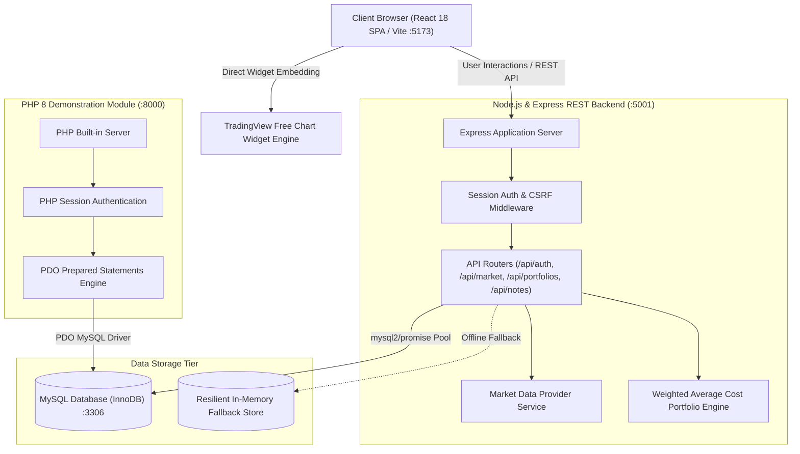

# StockPulse — Stock Market Intelligence & Portfolio Tracker

> **Educational Web Technology Capstone Platform** &bull; Full-Stack Financial Terminal & Simulated Portfolio Risk Management System demonstrating all 15 Web Technology Lab (WTL) Assignments.

---

## 1. Project Overview

**StockPulse** is an educational stock market intelligence and simulated portfolio dashboard designed with the information density and usability of professional financial research terminals combined with a modern fintech SaaS aesthetic.

The platform solves two simultaneous challenges:
1. **Financial Intelligence & Risk Analytics**: Provides real-time market indices, stock screening, TradingView technical charting, watchlist management, and simulated portfolio tracking with chronologically verified **Weighted Average Cost Basis** accounting and realized/unrealized P/L calculations.
2. **Academic Syllabus Completeness**: Delivers complete, isolated, and verifiable implementations of all **15 Web Technology Lab assignments** across HTML5, CSS3, Vanilla JavaScript, React 18 SPA, PHP 8 Sessions, PDO MySQL CRUD, and Node.js/Express REST APIs.

---

## 2. Key Features

- **Global Market Benchmarks**: Track major indices (S&P 500, NASDAQ, NIFTY 50, SENSEX, FTSE 100) with session change percentages.
- **TradingView Real-Time Charting**: Free TradingView Advanced Real-Time interactive charting widgets with timeframe controls (1m, 15m, 1h, Daily, Weekly, Monthly) and dark terminal styling.
- **Searchable Stock Screener**: Real-time filtering by ticker, company, or sector, column sorting, and regional filters (US vs. Indian Equities).
- **Simulated Paper Portfolio**:
  - Record hypothetical BUY and SELL orders with commission fee tracking.
  - Chronological **Weighted Average Cost Basis** engine.
  - Realized P/L calculations upon position liquidation.
  - Short-selling protection (enforces sufficient holdings before permitting sell orders).
  - 1-Click Simulation Reset to initial $100,000 cash balance.
- **MySQL-Backed Watchlist**: Personal watchlist persistence with real-time price updates.
- **Dual-Backend Demonstrator**:
  - **Node.js & Express REST API** for high-performance SPA JSON data feeds and sessions.
  - **Standalone PHP 8 Module** for PDO prepared statement CRUD, form handling, and session authentication.
- **Transparent Data Provenance**: Prominent `DEMO DATA (SIMULATED)` badges with metadata popovers distinguishing simulated test feeds from live market providers.
- **Interactive REST API Explorer**: Built-in HTTP console demonstrating native `fetch()`, status codes, request/response cycles, and JSON payload inspection.
- **15 WTL Lab Directory**: Interactive index and dedicated assignment views with test steps, file traceability, and viva examination prep.

---

## 3. Technology Stack

- **Frontend**: React 18, Vite 6, React Router DOM v6, Lucide React, TradingView Free Widgets, Vanilla CSS Design Tokens (Plus Jakarta Sans, Syne, JetBrains Mono).
- **Primary Backend**: Node.js v24, Express 4, mysql2/promise, express-session, cookie-parser, bcryptjs, dotenv, cors.
- **PHP Demonstration Module**: PHP 8.5, PDO MySQL, prepared statements, native PHP sessions.
- **Database**: MySQL 8 (InnoDB Engine), UTF8mb4 character set.

---

## 4. Architecture Diagram



---

## 5. Project Folder Structure

```
stockpulse/
├── backend/                       # Primary Node.js/Express REST API
│   ├── config/                    # Environment and MySQL pool configuration
│   ├── controllers/               # Auth, market, portfolio, notes, contact controllers
│   ├── middleware/                # Session auth, error handler, rate limiter
│   ├── routes/                    # Express modular route definitions
│   ├── services/                  # Market data provider & portfolio calculation engine
│   ├── tests/                     # Unit and integration test suites
│   ├── server.js                  # Main Express entrypoint
│   └── package.json
├── database/                      # SQL database scripts
│   ├── schema.sql                 # Table definitions and constraints
│   └── seed.sql                   # Deterministic sample seed data
├── docs/                          # Detailed architecture & reference documentation
│   ├── ARCHITECTURE.md            # System design and Mermaid diagrams
│   ├── API.md                     # Complete REST API endpoint reference
│   ├── DATABASE.md                # Schema documentation and ER diagram
│   ├── WTL-ASSIGNMENT-MAP.md      # Matrix mapping all 15 assignments to files
│   └── DEMO-SCRIPT.md             # Click-by-click exam demonstration guide
├── frontend/                      # React 18 SPA (Vite)
│   ├── public/wtl-standalone/     # Standalone HTML practicals served statically
│   ├── src/
│   │   ├── components/common/     # AppSidebar, TopBar, TradingViewChart, StockTable
│   │   ├── context/               # AuthContext, SettingsContext
│   │   ├── data/                  # WTL assignments metadata and viva notes
│   │   ├── pages/                 # Dashboard, Screener, StockDetail, Portfolio, etc.
│   │   ├── services/              # Unified Fetch API service client
│   │   ├── App.jsx                # Router shell
│   │   ├── index.css              # Financial dark terminal design tokens
│   │   └── main.jsx
│   ├── vite.config.js
│   └── package.json
├── php-module/                    # Standalone PHP 8 Demonstration Module
│   ├── config/database.php        # PDO connection setup
│   ├── includes/                  # Auth, header, footer, and sanitization functions
│   ├── public/                    # index.php, login.php, notes.php (CRUD), protected.php
│   └── README.md
├── wtl-lab/                       # 15 Isolated WTL Practical Directories
│   ├── 01-html-basics/            # Assignment 1: Headings, lists, images
│   ├── 02-semantic-html/          # Assignment 2: Semantic HTML5
│   ├── 03-css-methods/            # Assignment 3: Inline, internal, external CSS
│   ├── 04-responsive-layout/      # Assignment 4: Flexbox, Grid, media queries
│   ├── 05-css-positioning/        # Assignment 5: CSS positioning properties
│   ├── 06-javascript-arrays-events/ # Assignment 6: External JS & array methods
│   ├── 07-js-validation/          # Assignment 7: Client form validation
│   ├── 08-react-spa/              # Assignment 8: React SPA architecture
│   ├── 09-react-concepts/         # Assignment 9: Props, state, hooks
│   ├── 10-fetch-json/             # Assignment 10: Fetch API & JSON parsing
│   ├── 11-dom-manipulation/       # Assignment 11: Vanilla DOM manipulation
│   ├── 12-php-forms-sessions/     # Assignment 12: PHP forms & sessions
│   ├── 13-php-mysql-crud/         # Assignment 13: PHP PDO MySQL CRUD
│   ├── 14-express-server/         # Assignment 14: Express web server
│   └── 15-rest-api/               # Assignment 15: REST API CRUD with MySQL
├── .env.example                   # Environment configuration template
├── .gitignore
└── README.md
```

---

## 6. Prerequisites

- **Node.js**: v18+ (verified on Node v24)
- **npm**: v9+ (verified on npm v11)
- **MySQL**: 8.0+ (running locally on port 3306)
- **PHP**: 8.0+ with PDO MySQL extension (verified on PHP 8.5)

---

## 7. Installation & Quick Start

### 1. Database Setup
```bash
# Log in to MySQL and initialize the database & seed data
mysql -u root -e "CREATE DATABASE IF NOT EXISTS stockpulse;"
mysql -u root stockpulse < database/schema.sql
mysql -u root stockpulse < database/seed.sql
```

### 2. Environment Setup
```bash
cp .env.example .env
```
Default `.env` settings connect to `root` on `127.0.0.1:3306` with database `stockpulse`.

### 3. Install Dependencies
```bash
# Install backend dependencies
cd backend && npm install && cd ..

# Install frontend dependencies
cd frontend && npm install && cd ..
```

### 4. Running the Complete System (3 Independent Services)

| Service | Port | Start Command | URL |
| :--- | :--- | :--- | :--- |
| **Node/Express Backend** | `5001` | `cd backend && npm start` | `http://localhost:5001/api/health` |
| **Frontend React SPA** | `5173` | `cd frontend && npm run dev` | `http://localhost:5173/` |
| **PHP 8 Module** | `8000` | `php -S localhost:8000 -t php-module/public` | `http://localhost:8000/index.php` |

---

## 8. Automated Testing

Run the backend unit and integration test suite:
```bash
cd backend && npm test
```
**Test Coverage Includes**:
- Weighted Average Cost Basis calculation on multi-lot buy orders.
- Partial position liquidation and fee-deducted realized P/L.
- Insufficient holdings validation (blocking sales of unowned shares).
- Global market indices retrieval and data provenance metadata.
- Case-insensitive stock search and time series normalization.

Build validation for frontend:
```bash
cd frontend && npm run build
```

---

## 9. Demo Credentials

For immediate login without registering:
- **Email**: `demo@stockpulse.finance`
- **Password**: `Password123!`
- *(A 1-click **Autofill** button is provided on `/login`)*

---

## 10. The 15 WTL Lab Assignments Summary

Access `/wtl-lab` in the web application to interact with all 15 assignments directly.

1. **Assignment 1**: HTML Headings, Lists, and Images (`wtl-lab/01-html-basics/index.html`)
2. **Assignment 2**: Semantic HTML Structure (`wtl-lab/02-semantic-html/index.html`)
3. **Assignment 3**: Inline, Internal, and External CSS (`wtl-lab/03-css-methods/index.html`)
4. **Assignment 4**: Responsive Design with Flexbox, Grid & Media Queries (`wtl-lab/04-responsive-layout/index.html`)
5. **Assignment 5**: CSS Positioning & Visual Properties (`wtl-lab/05-css-positioning/index.html`)
6. **Assignment 6**: External JS, Events & Array Functions (`wtl-lab/06-javascript-arrays-events/index.html`)
7. **Assignment 7**: Frontend Functionality & Client Form Validation (`wtl-lab/07-js-validation/index.html`)
8. **Assignment 8**: Basic React SPA using Components & JSX (`frontend/src/main.jsx`)
9. **Assignment 9**: React Props, State, Hooks & Conditional Rendering (`frontend/src/pages/MarketsPage.jsx`)
10. **Assignment 10**: Fetch API & JSON Serialization (`frontend/src/pages/ApiExplorerPage.jsx`)
11. **Assignment 11**: Direct Vanilla DOM Manipulation (`wtl-lab/11-dom-manipulation/index.html`)
12. **Assignment 12**: PHP Forms, Validation & Sessions (`php-module/public/login.php`)
13. **Assignment 13**: PHP PDO MySQL CRUD with Prepared Statements (`php-module/public/notes.php`)
14. **Assignment 14**: Node.js & Express Web Server Architecture (`backend/server.js`)
15. **Assignment 15**: REST API with Express & Database Connectivity (`backend/routes/notesRoutes.js`)

Detailed examination viva answers and demonstration workflows are available in [docs/DEMO-SCRIPT.md](docs/DEMO-SCRIPT.md) and [docs/WTL-ASSIGNMENT-MAP.md](docs/WTL-ASSIGNMENT-MAP.md).

---

## 11. Known Limitations & Educational Disclaimers

- **Educational Simulation**: All portfolio buy and sell orders are paper trades recorded in the database. No brokerage execution, financial advice, or fiat money deposits are performed.
- **Free TradingView Widgets**: Live charts utilize TradingView's free embeddable widget engine which requires an active internet connection to load scripts from `s3.tradingview.com`.
- **Market Data Mode**: In standard demo mode, asset prices and volume prints reflect deterministic seeded data. Live market data can be toggled by specifying a valid provider API key in `.env`.

---

## 12. License & Author
Built as an expert-level full-stack master project by Reyyan Sayyed for Web Technology Lab evaluation. Open-source educational reference under the MIT License.
# stockpulse
